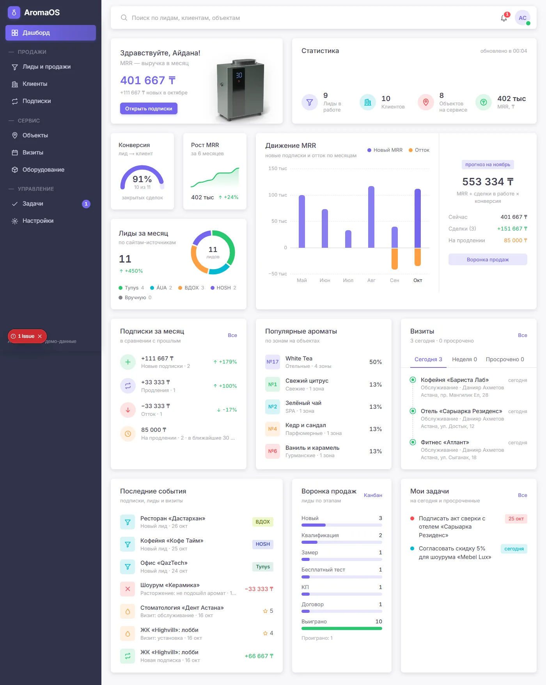
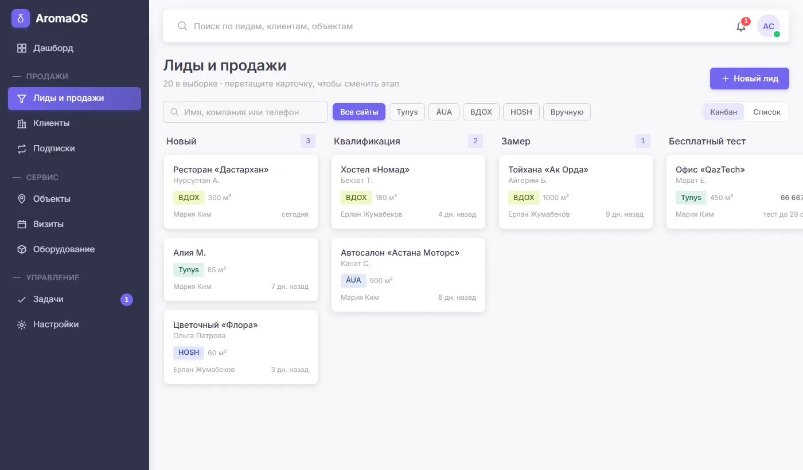
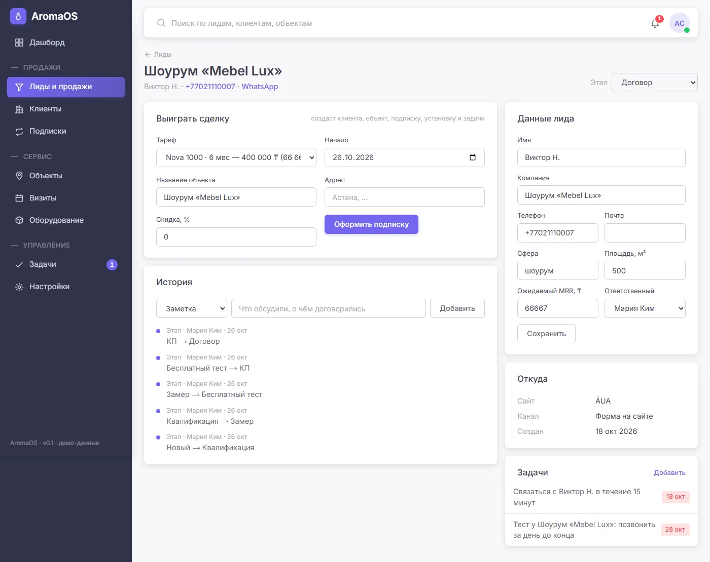
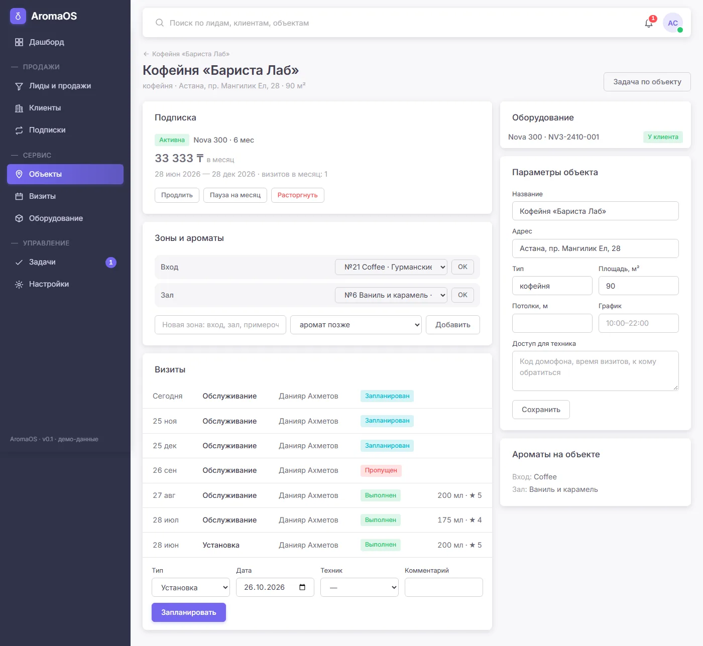
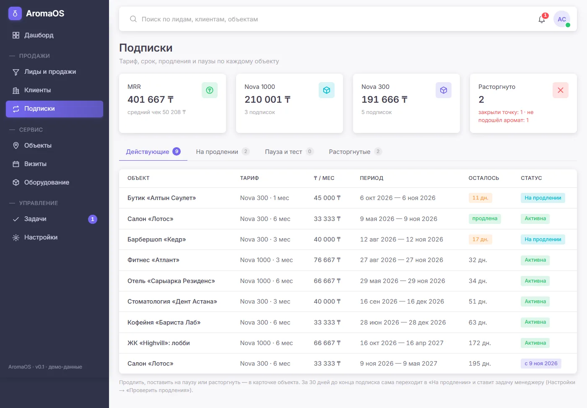
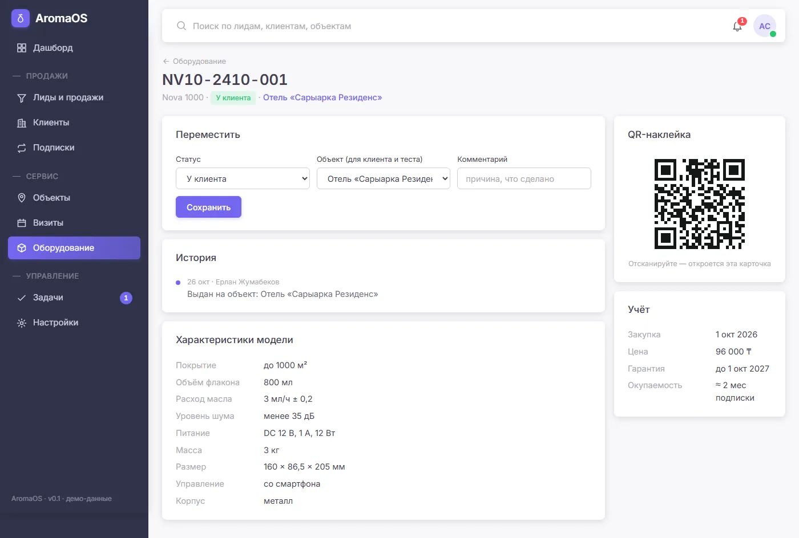
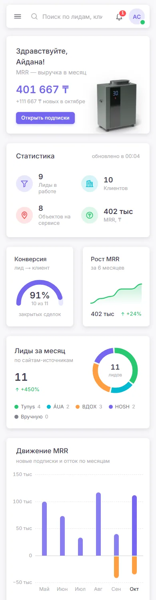
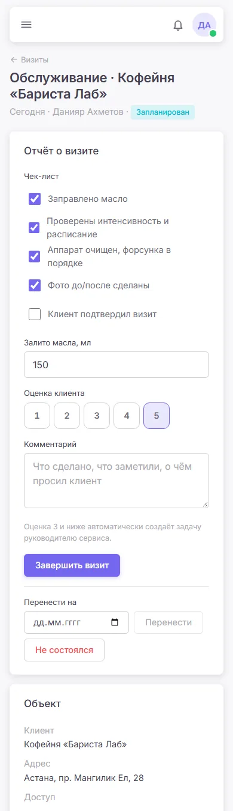

# AromaOS

Система управления бизнесом аромамаркетинга в Астане: **лиды → клиенты → объекты → подписки**, сервисные визиты, оборудование и задачи — в одном веб-приложении.

Статус: **v0.1, MVP-ядро**. Работает на демо-данных (компании и люди вымышленные, цены — из прайса Nova 300 / Nova 1000). К сайтам пока не подключена — лиды вносятся вручную.

**Посмотреть без установки:** https://t0niske.github.io/aromaos-demo/ — та же система целиком в браузере, без входа и без сервера ([как устроено](#браузерная-демо-версия)).



| Воронка продаж | Карточка лида |
|---|---|
|  |  |
| **Объект: подписка, зоны, визиты** | **Подписки на продлении** |
|  |  |
| **Аппарат с QR-наклейкой** | **С телефона: дашборд и визит техника** |
|  |   |

## Запустить у себя

Нужен Node.js 20+. База встроенная (PGlite) — ставить PostgreSQL не надо.

```bash
git clone https://github.com/t0niske/aromaos.git && cd aromaos
npm install
npm run setup     # .env.local с секретом + демо-база
npm run dev       # http://localhost:3000
```

### Демо-входы

| Роль | Почта | Пароль | Что видит |
|---|---|---|---|
| Собственник | `owner@aromaos.local` | `demo-owner-2026` | всё, включая настройки и журнал |
| Менеджер продаж | `sales@aromaos.local` | `demo-sales-2026` | лиды, клиенты, объекты, подписки |
| Руководитель сервиса | `service@aromaos.local` | `demo-service-2026` | объекты, визиты, оборудование |
| Техник | `tech@aromaos.local` | `demo-tech-2026` | только свои визиты (удобно с телефона) |

Это локальные демо-учётки для базы на вашем компьютере, не для продакшена.

### Что посмотреть за 5 минут

1. **Дашборд** под собственником — MRR и прогноз, движение MRR по месяцам (новые подписки и отток), конверсия, лиды по 4 сайтам, популярные ароматы, визиты и лента событий. Строка поиска сверху ищет по лидам, клиентам и объектам; колокольчик — просроченные задачи.
2. **Лиды** — перетащите карточку между этапами; откройте лид «Шоурум» на этапе «Договор» и нажмите **«Оформить подписку»**: система сама создаст клиента, объект, подписку, график визитов на весь срок, выдаст аппарат со склада и поставит задачи.
3. **Объект** — добавьте зону (вход, зал) и выберите ей аромат из коллекции; поставьте подписку на паузу или продлите.
4. Войдите **техником** с телефона → «Мои визиты» → визит на сегодня → поставьте оценку 2: у руководителя сервиса появится задача разобраться.
5. **Оборудование** → любой аппарат: QR-наклейка ведёт прямо на его карточку.

## Что умеет

| Раздел | Возможности |
|---|---|
| Дашборд | MRR и прогноз на следующий месяц, движение MRR за 6 месяцев (новые подписки вверх, отток вниз), рост MRR, конверсия, лиды за месяц по сайтам, подписки за месяц (новые / продления / отток), популярные ароматы, визиты сегодня / неделя / просрочено, лента событий, воронка, мои задачи |
| Поиск | по лидам (имя, компания, телефон, почта), клиентам (название, БИН) и объектам (название, адрес) — только по разделам, доступным роли |
| Лиды и продажи | канбан с перетаскиванием (Новый → Квалификация → Замер → Тест → КП → Договор → Выиграно / Проиграно), список с поиском и фильтром по сайту, история и заметки, «Выиграть» с выбором тарифа |
| Клиенты | ТОО/ИП/АО, БИН, НДС, госсектор, контакты и ЛПР, объекты, MRR и сумма договоров, средняя оценка визитов |
| Объекты | зоны с ароматами (32 аромата коллекции), аппараты, подписка: оформить, продлить, пауза, расторгнуть; визиты; доступ и график для техника |
| Подписки | действующие, на продлении, пауза и тест, расторгнутые; MRR по моделям, причины оттока |
| Визиты | сегодня / неделя / просрочено / выполнено; отчёт техника с телефона: чек-лист, масло, оценка клиента, перенос |
| Оборудование | реестр Nova 300 / Nova 1000 по статусам, приёмка на склад, перемещения и история, QR-наклейка, окупаемость |
| Задачи | мои / все / выполненные, просрочки, привязка к лиду и объекту |
| Настройки | команда и роли, тарифы, проверка продлений, журнал действий |

**Автоматизации:**
- новый лид → ответственный (у кого меньше открытых) + задача «связаться за 15 минут»; повторный номер → в историю открытого лида;
- этап «Тест» → задача позвонить за день до конца теста;
- сделка выиграна → клиент, контакт, объект, подписка, график визитов, аппарат со склада, 3 задачи онбординга; задачи продажи закрываются;
- оценка визита ≤ 3 → задача руководителю сервиса;
- расторжение → отмена будущих визитов + визит на демонтаж;
- за 30 дней до конца подписки → «На продлении» + задача менеджеру.

## Как устроено

- Next.js 16 (App Router, Cache Components: каркас страницы мгновенно, данные потоком), TypeScript, Tailwind 4, светлая и тёмная тема. Графики дашборда — свой SVG/CSS на сервере, без библиотек (`src/components/charts.tsx`).
- Drizzle ORM + PostgreSQL. Схема — [`src/db/schema.ts`](src/db/schema.ts), бизнес-процессы — [`src/lib/domain.ts`](src/lib/domain.ts), роли — [`src/lib/access.ts`](src/lib/access.ts).
- Без `DATABASE_URL` — встроенный PostgreSQL (PGlite) в `data/`; с `DATABASE_URL` — обычный PostgreSQL.
- Сессии — подписанная cookie, пароли — scrypt; каждое действие проверяет роль на сервере и пишется в журнал.
- Деньги — целые тенге, даты — по времени Астаны.

| Команда | Что делает |
|---|---|
| `npm run setup` | `.env.local` с секретом + демо-база |
| `npm run dev` / `build` | разработка / продакшен-сборка |
| `npm run db:seed` / `db:reset` | заново наполнить / пересоздать базу |
| `npm run db:generate` | миграция после правки схемы |
| `npm run demo` / `demo:build` | браузерная демо-версия: разработка / сборка |
| `npm run typecheck`, `npm run lint` | проверки |

PGlite однопроцессный: наполнение базы и сервер не запускайте одновременно. Если после аварийной остановки сервера база не открывается — `npm run db:reset`.

## Браузерная демо-версия

Те же страницы `src/app`, собранные в статический сайт для GitHub Pages ([t0niske/aromaos-demo](https://github.com/t0niske/aromaos-demo)): PostgreSQL (PGlite) работает прямо в браузере, входа нет — открывается под собственником, роль меняется в плашке «Демо».

- `npm run demo` — разработка (http://localhost:3200), `npm run demo:build` — сборка в `dist-demo/`.
- [`scripts/demo-snapshot.ts`](scripts/demo-snapshot.ts) при сборке собирает базу с демо-данными в готовый снимок; браузер загружает его в память и сдвигает все даты к сегодняшнему дню. Изменения живут до перезагрузки страницы.
- [`vite.demo.config.ts`](vite.demo.config.ts) подменяет серверные модули браузерными из [`demo/`](demo): базу, вход, `next/*`. Функции из файлов `'use server'` вызываются напрямую, серверные компоненты рендерит [`demo/runtime/rsc.ts`](demo/runtime/rsc.ts), адреса — в hash (`#/leads/17`).
- Ссылка `…/#/login?as=tech` открывает систему сразу под ролью (`owner`, `sales`, `service`, `tech`).
- Опубликовать: `npm run demo:build`, затем содержимое `dist-demo/` — в репозиторий `aromaos-demo` (ветка `main`, GitHub Pages из корня).

## Дальше

Приём заявок с сайтов Tynys, ÁUA, ВДОХ, HOSH; счета и оплата Kaspi, АВР; склад масел и закупки; кабинет клиента; приложение техника офлайн; казахский язык; хостинг и база на серверах в РК.
